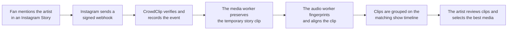
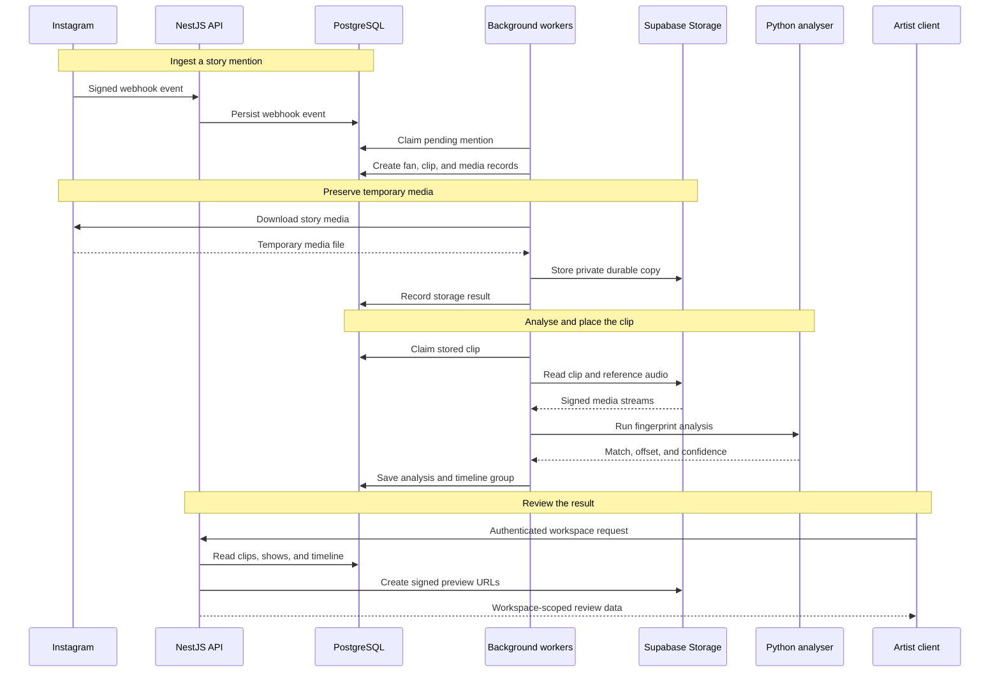

# CrowdClip API

CrowdClip is an in-progress backend for collecting fan-shot concert clips and
turning them into an artist-owned media timeline. It receives Instagram story
mention webhooks, preserves temporary media in private storage, and aligns clip
audio against reference recordings so clips from the same moment can be
grouped together.

This repository contains the backend, database migrations, background workers,
and audio-analysis implementation. The frontend is maintained separately.

## What is implemented

- Instagram OAuth, webhook verification, and story-mention ingestion
- Supabase authentication with workspace-scoped access
- PostgreSQL migrations and row-level security policies
- Background media download and storage processing
- Original-file request and upload-token workflows
- Audio fingerprinting, reference-track alignment, and show timelines
- Interactive OpenAPI documentation through Swagger

## How CrowdClip works



## Architecture

The main API is a NestJS application backed by PostgreSQL and Supabase Storage.
Database-backed workers process webhook events, copy expiring Instagram media,
and invoke the Python audio analyser as a child process.



The audio alignment implementation and its evaluation are documented in
[`audio-analysis/README.md`](audio-analysis/README.md). Database migrations and
local Supabase configuration live under [`supabase/`](supabase/).

## Prerequisites

- Node.js 20 or newer
- pnpm 10
- Docker Desktop (for the local Supabase stack)
- Supabase CLI, installed through this project's dependencies
- Python 3 and FFmpeg (only for audio analysis)

## Local setup

Install the JavaScript dependencies and create your local configuration:

```bash
pnpm install
cp .env.example .env.local
pnpm exec supabase start
pnpm start:local
```

`start:local` reads the local API URL and service-role key directly from the
Supabase CLI, exports them to the Nest process, and starts the development
server. It does not print or persist those credentials.

The API defaults to <http://localhost:3000>. With it running, Swagger UI is at
<http://localhost:3000/docs> and the OpenAPI document is at
<http://localhost:3000/docs-json>.

To exercise the Instagram integration, create a Meta app, configure its OAuth
and webhook callbacks, and add its credentials to `.env.local`. Meta must be
able to reach the callback endpoints over HTTPS. See
[`.env.example`](.env.example) for every setting and its purpose. Never commit
`.env`, `.env.local`, Meta credentials, Supabase service-role keys, or signing
secrets.

### Audio analysis

The API can run without the optional analyser. To enable it:

```bash
cd audio-analysis
python3 -m venv .venv
.venv/bin/pip install -r requirements.txt
cd ..
```

The default `AUDIO_ANALYSIS_PYTHON_PATH` already points to that virtual
environment.

### CA$INO demo media

The read-only `GET /demo` endpoint exposes the Baby Keem CA$INO timeline demo.
Its excerpts are stored in the private `demo-media` Supabase bucket and returned
as short-lived signed URLs. Browser database roles cannot read the metadata
table or Storage objects directly.

Apply the migration, configure the server-side Supabase values, and explicitly
seed the bounded excerpts:

```bash
pnpm exec supabase migration up --local
pnpm demo:seed
```

The seed is idempotent: stored excerpts are skipped, failures are recorded per
source, and no public endpoint can start a download. Each source is constrained
to a 12-second range, re-encoded as MP4, capped at 25 MiB, and attributed in the
API response. The supplied local reference MP3 is not copied into the repository
or uploaded by this command.

Current yt-dlp releases require Python 3.10 or newer. If macOS resolves
`python3` to an older system Python, set `DEMO_MEDIA_PYTHON_PATH` to a compatible
absolute path, such as `/opt/homebrew/bin/python3`.

## Development checks

```bash
pnpm format:check       # formatting
pnpm lint               # TypeScript linting
pnpm test --runInBand --watchman=false
pnpm build
pnpm test:e2e --runInBand --watchman=false
pnpm test:db            # requires the local Supabase stack

cd audio-analysis
.venv/bin/python -m pytest tests
```

The progressive authentication integration test also requires local Supabase:

```bash
pnpm test:auth:local
```

Bug reports and focused contributions are welcome; read
[`CONTRIBUTING.md`](CONTRIBUTING.md) before opening a pull request. Please
report security issues according to [`SECURITY.md`](SECURITY.md), not in a
public issue.

## License

Licensed under the Apache License, Version 2.0. See [`LICENSE`](LICENSE).
